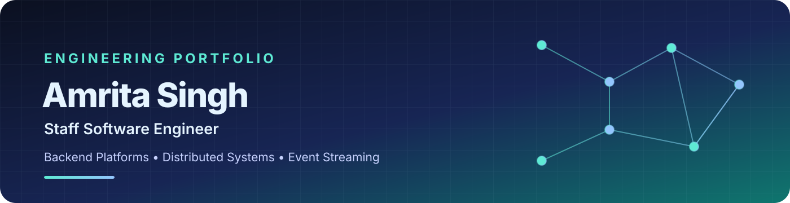

  

  
  
  

  <strong>Staff Software Engineer at Walmart Global Tech</strong> 
  Distributed systems · Data platforms · GenAI integrations · Technical leadership

---

## 🧭 Navigate

  <a href="#-about-me">About</a> &nbsp;•&nbsp;
  <a href="#-engineering-highlights">Impact</a> &nbsp;•&nbsp;
  <a href="#-experience">Experience</a> &nbsp;•&nbsp;
  <a href="#-technical-toolkit">Tech stack</a> &nbsp;•&nbsp;
  <a href="#-education">Education</a> &nbsp;•&nbsp;
  <a href="#-lets-connect">Contact</a>

## 👋 About me

I’m **Amrita Singh**, a Staff Software Engineer with **14+ years of experience** building backend services, distributed systems, and event-driven platforms. At Walmart Global Tech, I work on Walmart Marketplace’s multi-channel notifications platform, which delivers **100M+ notifications daily** to sellers, suppliers, and partners.

My work combines hands-on engineering with platform architecture, production reliability, security, large-scale data migrations, and cross-team technical alignment. I also work on applied GenAI integrations, including MCP servers and AI-agent workflows for webhook operations, plus knowledge-base exposure through a RAG capability used by Marty, Walmart’s seller-facing AI assistant. I enjoy solving complex systems problems and building reusable capabilities that help engineering teams deliver services safely and consistently.

## ✨ Engineering highlights

<table>
  <tr>
    <td width="50%" valign="top">
      <h3>🚦 100M+ notifications daily</h3>
      Engineering on a high-volume, multi-channel marketplace notifications platform using Java, Spring Boot, Kafka and Apache Flink.
    </td>
    <td width="50%" valign="top">
      <h3>🔁 ~7M subscriptions migrated</h3>
      Contributed to subscription migration work completed within the planned quarter-end timeline.
    </td>
  </tr>
  <tr>
    <td width="50%" valign="top">
      <h3>🔐 20+ Flink deployments</h3>
      Extended shared-library support for workload identity adoption and helped plan a phased rollout across 30 workloads.
    </td>
    <td width="50%" valign="top">
      <h3>📈 Production observability</h3>
      Built notification dashboards covering five channels, including delivery funnels, failures, and p50/p95 latency.
    </td>
  </tr>
  <tr>
    <td width="50%" valign="top">
      <h3>🧭 Architecture & collaboration</h3>
      Serve as a platform design authority and work with architects, Principal Engineers, IAM, Product and partner teams on technical trade-offs.
    </td>
    <td width="50%" valign="top">
      <h3>🤖 GenAI: MCP & AI-agent workflows</h3>
      Built and onboarded an MCP server with tool definitions and backend API calls for webhook management, plus an AI-agent workflow. A stakeholder demo led to a related product-intake item.
    </td>
  </tr>
</table>

## 💼 Experience

  
<strong>Walmart Global Tech — Staff Software Engineer</strong> · February 2022–Present · Bengaluru

  - Lead engineering on Walmart Marketplace’s event-driven notification platform, delivering 100M+ notifications a day.
  - Serve as design authority and primary reviewer for platform-level architecture changes; align architects, Principal Engineers, IAM, Product and partner teams.
  - Extended shared-library support for workload identity adoption across 20+ Flink deployments and helped plan the rollout across 30 workloads.
  - Contributed to migration work involving approximately 7 million subscriptions, delivered within the planned quarter-end timeline.
  - Led root-cause analysis for high-visibility incidents by tracing issues across Kafka offsets, Flink job state and downstream delivery.
  - Worked on Kubernetes and Istio migration, service-to-service security, HMAC webhook verification and shared platform library upgrades.
  - Built a live notification-metrics dashboard covering five channels, with delivery funnels, failures and p50/p95 latency.
  - Built and onboarded an MCP server with tool definitions and backend API calls for webhook management, and developed an AI-agent workflow for webhook notification operations.
  - Contributed to exposing the Walmart Marketplace knowledge base through a RAG capability used by Marty, Walmart’s seller-facing AI assistant; my work focused on knowledge-base exposure and service/API integration.

  
<strong>Focus:</strong> Platform architecture, distributed systems, event streaming, migrations, production reliability, service security and engineering alignment.

  
<strong>Dell EMC — Senior Software Engineer</strong> · January 2020–December 2021 · Bengaluru

  - Developed Java and Spring Boot microservices and helped lead delivery of a web version of an Electron-based application.
  - Worked on secure inter-service communication, code signing, MQTT communication channels and deployment pipelines.
  - Built tooling to communicate with remote servers and run tools in non-GUI Linux environments.

  
<strong>Dell EMC (via JK Technosoft) — Software Engineer</strong> · December 2018–January 2020 · Bengaluru

  Built and maintained a cross-platform troubleshooting desktop application using Angular, Node.js and Electron, including network validation, remote calls and secure execution features.

  
<strong>NIIT Ltd. — Software Developer & Technical Trainer</strong> · October 2017–October 2018 · Kolkata

  Developed client-server applications and REST services using Spring, Hibernate, Angular and Node.js; trained developers in server-side technologies, architectures and design patterns.

  
<strong>NSCT — Associate Software Developer</strong> · August 2012–September 2017 · Kolkata

  Worked on Java-based web applications, REST services, data modelling, SQL, and web interfaces.

## 🤖 Applied GenAI experience

- **MCP & AI agents:** Built and onboarded an MCP server with tool definitions and backend API calls for webhook-management capabilities; developed an AI-agent workflow for webhook notification operations.
- **Seller knowledge & RAG:** Contributed to knowledge-base exposure and service/API integration for a RAG capability used by Marty, Walmart’s seller-facing AI assistant, to help sellers find answers about the Walmart ecosystem.
- **Scope:** My contribution focused on the MCP implementation and the knowledge-base/service integration; I did not build the Marty assistant itself or claim end-to-end ownership of its integration.

## 🧰 Technical toolkit

<strong>GenAI & applied AI</strong> 
  
  
  
  
  

<strong>Languages & backend</strong> 
  
  
  
  
  

<strong>Streaming & distributed systems</strong> 
  
  
  
  
  
  

<strong>Data, cloud-native & delivery</strong> 
  
  
  
  
  
  
  
  
  

  
<strong>More areas of practice</strong>

  - **Security:** HMAC/webhook authentication, API gateway policies, mTLS, code signing.
  - **Reliability:** Incident RCA, delivery-failure investigation, latency monitoring and production hardening.
  - **AI & integration:** MCP servers, AI agents and webhook integrations.
  - **Frontend and application tooling:** JavaScript, TypeScript, Angular, Node.js and Electron.

## 🎓 Education

| Qualification | Institution | Year |
|---|---|---|
| Master of Computer Applications (MCA) | IGNOU | 2020 |
| Post Graduate Diploma in Computer Applications (PGDCA) | IGNOU | 2015 |
| Bachelor of Computer Applications (BCA) | West Bengal University of Technology | 2009–2012 |

## 🤝 Let's connect

  
  
  

Built around practical engineering, thoughtful architecture, and reliable systems.

---

Note: The proposed Flink redesign and its throughput/operational improvements are projections, not measured production results. They are not presented as delivered outcomes here.
