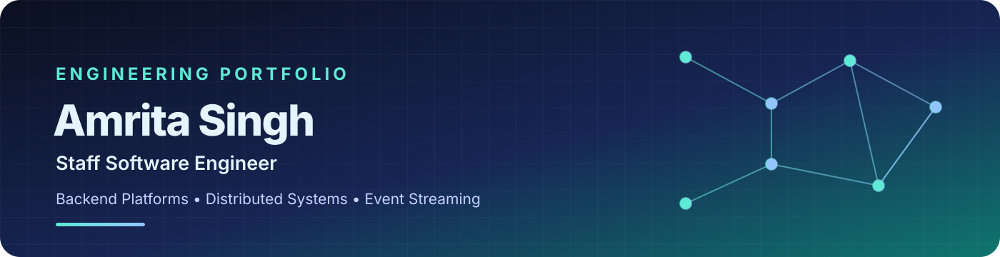

<!--
  README designed as the GitHub companion to index.html.
  Keep the visual identity, headline, impact metrics and section order aligned
  with the portfolio website.
-->

  

  <strong>STAFF SOFTWARE ENGINEER</strong> &nbsp;·&nbsp; BENGALURU, INDIA
   
  Distributed Systems &nbsp;·&nbsp; Data Platforms &nbsp;·&nbsp; Applied GenAI

  <a href="Amrita_Singh_Resume.pdf">Résumé PDF ↗</a>
  &nbsp;·&nbsp;
  <a href="mailto:einkal4@gmail.com">Email ↗</a>
  &nbsp;·&nbsp;
  <a href="https://github.com/einkal">GitHub ↗</a>
  &nbsp;·&nbsp;
  <a href="./index.html">Portfolio website ↗</a>

---

  <strong>100M+</strong> &nbsp; notifications / day
  &nbsp;&nbsp;·&nbsp;&nbsp;
  <strong>14+</strong> &nbsp; years engineering
  &nbsp;&nbsp;·&nbsp;&nbsp;
  <strong>10</strong> &nbsp; engineers led
  &nbsp;&nbsp;·&nbsp;&nbsp;
  <strong>7M</strong> &nbsp; subscriptions migrated

---

## Building dependable systems at scale.

I'm **Amrita Singh**, a Staff Software Engineer with 14+ years of experience designing, building and evolving enterprise software.

At Walmart Global Tech, I work on marketplace notification platforms serving sellers, suppliers and partners. My experience spans backend engineering, distributed systems, event streaming, data migrations, platform security and production reliability. I work across teams to turn system-level design decisions into dependable production outcomes.

More recently, I've also worked on practical AI integrations, including MCP-based webhook operations and service/API integration for a RAG capability used by Walmart's seller-facing AI assistant, Marty.

> **My engineering lens:** thoughtful architecture, clear trade-offs, operational ownership and solutions that work in production.

---

## Selected engineering work

<table>
  <tr>
    <td width="50%" valign="top">
      
01 / DISTRIBUTED SYSTEMS

      <h3>Marketplace notifications at scale</h3>
      
Engineering on a multi-channel, event-driven platform delivering <strong>100M+ notifications each day</strong> using Java, Spring Boot, Kafka and Apache Flink.

      
JAVA · KAFKA · FLINK · SPRING BOOT

    </td>
    <td width="50%" valign="top">
      
02 / REUSABLE PLATFORM CAPABILITIES

      <h3>Workload identity adoption</h3>
      
Extended shared-library support and planned phased workload identity adoption across 30 workloads, supporting 20+ Flink deployments and multiple Kafka connections.

      
WORKLOAD IDENTITY · KUBERNETES · MTLS

    </td>
  </tr>
  <tr>
    <td width="50%" valign="top">
      
03 / DATA MIGRATION

      <h3>Subscription migration</h3>
      
Contributed to ETL and migration work across Azure SQL and Redis involving approximately <strong>7 million subscriptions</strong>.

      
ETL · AZURE SQL · REDIS · DATA VALIDATION

    </td>
    <td width="50%" valign="top">
      
04 / OPERABILITY & INCIDENT RESPONSE

      <h3>Production signals that matter</h3>
      
Led cross-service incident investigations and built a live dashboard across five notification channels, covering delivery funnels, failures and p50/p95 latency.

      
OBSERVABILITY · INCIDENT RCA · LATENCY

    </td>
  </tr>
  <tr>
    <td width="50%" valign="top">
      
05 / SECURITY & MODERNIZATION

      <h3>Safer service integrations</h3>
      
Worked on Kubernetes and Istio migration, mTLS troubleshooting, HMAC webhook verification, API gateway policies and shared-library upgrades.

      
KUBERNETES · ISTIO · MTLS · HMAC

    </td>
    <td width="50%" valign="top">
      
06 / APPLIED GENAI

      <h3>MCP, AI agents and seller knowledge</h3>
      
Built an MCP server and AI-agent workflow for webhook operations. Also contributed to knowledge-base exposure and service/API integration for a RAG capability used by Marty.

      
MCP · AI AGENTS · RAG · API INTEGRATION

    </td>
  </tr>
</table>

---

## Applied GenAI

**MCP server — webhook operations**

Built and onboarded an MCP server with tool definitions and backend API calls to expose webhook-management capabilities to AI assistants. Developed an AI-agent workflow for webhook notification operations and demonstrated the solution to stakeholders.

**Seller knowledge discovery — RAG**

Contributed to exposing the Walmart Marketplace knowledge base through a RAG capability used by Marty, Walmart's seller-facing AI assistant. My contribution focused on knowledge-base exposure and service/API integration, not end-to-end ownership of Marty.

---

## Experience

  
<strong>Staff Software Engineer</strong> · Walmart Global Tech · February 2022–Present · Bengaluru

  - Lead engineering on a high-volume, multi-channel marketplace notifications platform.
  - Serve as a design authority and reviewer for platform-level architecture changes, aligning architects, Principal Engineers, IAM, Product and partner teams.
  - Support large-scale migrations, shared-library adoption, service security and production reliability.
  - Lead high-visibility incident investigations across Kafka offsets, Flink job state and downstream delivery.
  - Built a live notification metrics dashboard covering five channels, delivery funnels, failures and p50/p95 latency.
  - Built and onboarded an MCP server for webhook management and an AI-agent workflow; contributed to knowledge-base exposure and service/API integration for a RAG capability used by Marty.

  
<strong>Senior Software Engineer</strong> · Dell EMC · January 2020–December 2021 · Bengaluru

  - Developed Java and Spring Boot microservices and helped lead delivery of a web version of an Electron-based application.
  - Worked on secure inter-service communication, code signing, MQTT communication channels and deployment pipelines.
  - Built tooling to communicate with remote servers and run tools in non-GUI Linux environments.

  
<strong>Software Engineer</strong> · Dell EMC (via JK Technosoft) · December 2018–January 2020 · Bengaluru

  Built and maintained a cross-platform troubleshooting application using Angular, Node.js and Electron, including network validation, remote calls and secure execution features.

  
<strong>Senior TechMentor</strong> · NIIT Ltd. · October 2017–October 2018 · Kolkata

  - Developed client-server functionality for the Skill Map Engine using Spring, Hibernate, REST APIs, Maven and jQuery.
  - Built single-page application features using Angular and Node.js, integrating frontend components with backend REST services.
  - Implemented application functionality using JSON, REST APIs and Spring Security.
  - Delivered technical training in Node.js, J2EE, application architecture, frameworks, design patterns and refactoring practices.

  
<strong>Associate Software Developer</strong> · NSCT · August 2012–September 2017 · Kolkata

  - Contributed to Profile & Resume Builder, an E-commerce Portal (DevOps), and a Collaboration Platform for blogs and forums.
  - Developed Java web application features and responsive interfaces using JavaScript, AngularJS, Bootstrap, HTML5 and CSS3.
  - Implemented role-based access functionality and translated UI designs and prototypes into working application features.
  - Worked with relational database design, data modelling, SQL optimization, Unix shell scripting and Agile/TDD practices.

---

## Technical expertise

<table>
  <tr>
    <td width="50%" valign="top">
      <h3>Backend engineering</h3>
      Java 8–21 · Spring Boot · Spring Security · Hibernate/JPA · REST APIs · Microservices
    </td>
    <td width="50%" valign="top">
      <h3>Streaming & distributed systems</h3>
      Apache Kafka · Apache Flink · Kafka Streams · Hadoop · RabbitMQ · MQTT
    </td>
  </tr>
  <tr>
    <td width="50%" valign="top">
      <h3>Data & search</h3>
      Azure SQL · Cosmos DB · Redis · Elasticsearch/OpenSearch · MongoDB · ETL · Data validation
    </td>
    <td width="50%" valign="top">
      <h3>Cloud-native delivery</h3>
      Kubernetes · Docker · Istio/mTLS · Jenkins · CI/CD · Maven · Gradle · Git
    </td>
  </tr>
  <tr>
    <td width="50%" valign="top">
      <h3>Security & reliability</h3>
      HMAC/webhook authentication · API gateway policies · Incident RCA · Latency monitoring · Production hardening
    </td>
    <td width="50%" valign="top">
      <h3>GenAI & integrations</h3>
      MCP servers · Tool definitions · AI-agent workflows · RAG knowledge-base integration · LlamaIndex · OpenAI embeddings · Milvus
    </td>
  </tr>
</table>

---

## How I work

- **Architecture with context** — evaluate system changes against reliability, security, performance and operational cost.
- **Cross-team alignment** — bring architects, platform teams, IAM, Product and partner teams toward workable decisions.
- **Production ownership** — trace failures across system boundaries, communicate findings and follow through on remediation.
- **Engineer enablement** — improve shared capabilities and support engineers through design reviews, mentoring and onboarding.

---

## Education

| Qualification | Institution | Year |
|---|---|---:|
| Master of Computer Applications (MCA) | IGNOU | 2020 |
| Post Graduate Diploma in Computer Applications (PGDCA) | IGNOU | 2015 |
| Bachelor of Computer Applications (BCA) | West Bengal University of Technology | 2009–2012 |

---

## Let’s connect

  <strong>Interested in backend engineering, distributed systems, platform architecture and applied AI.</strong>
    
  <a href="mailto:einkal4@gmail.com">Email Amrita ↗</a>
  &nbsp;·&nbsp;
  <a href="https://github.com/einkal">GitHub ↗</a>
  &nbsp;·&nbsp;
  <a href="Amrita_Singh_Resume.pdf">View résumé PDF ↗</a>
  &nbsp;·&nbsp;
  <a href="./index.html">Portfolio website ↗</a>

Practical engineering · Thoughtful architecture · Reliable systems

---

Portfolio summaries are intentionally high-level and exclude confidential implementation details. Proposed redesigns and projected benefits are not represented as measured production outcomes.
